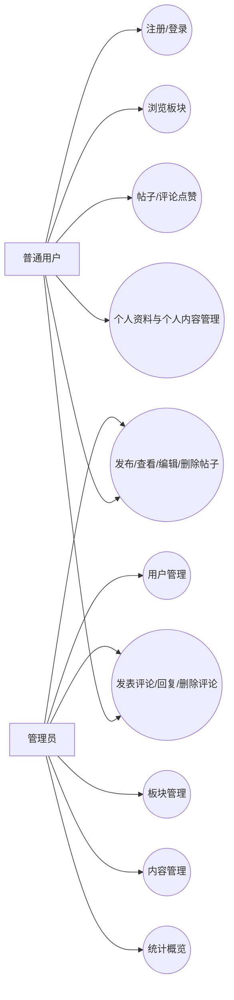
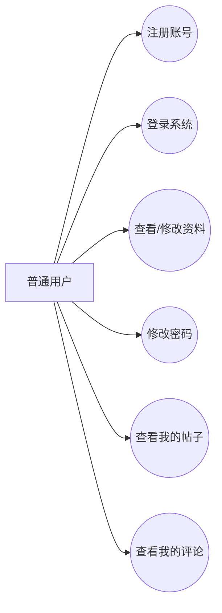
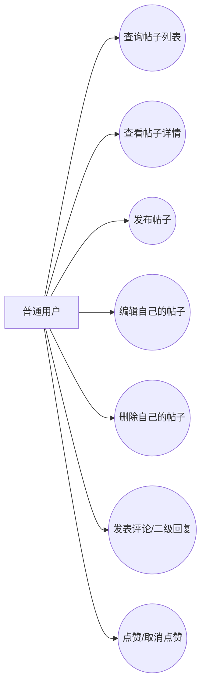
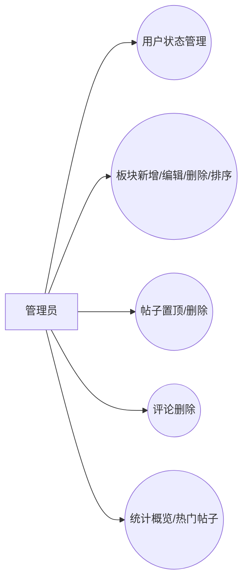
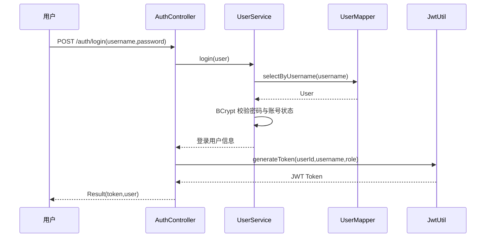
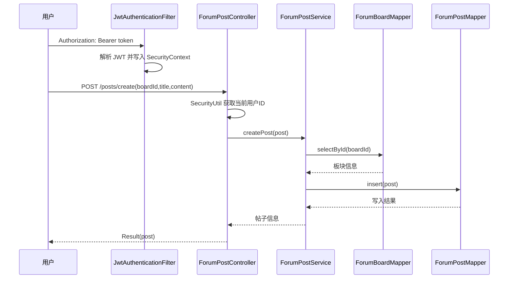
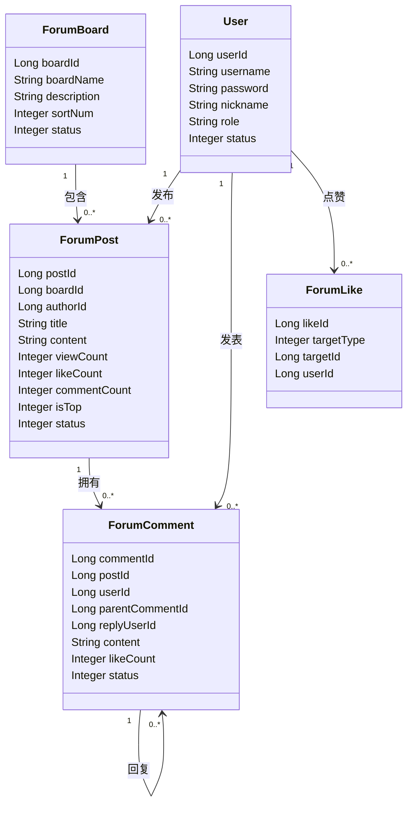
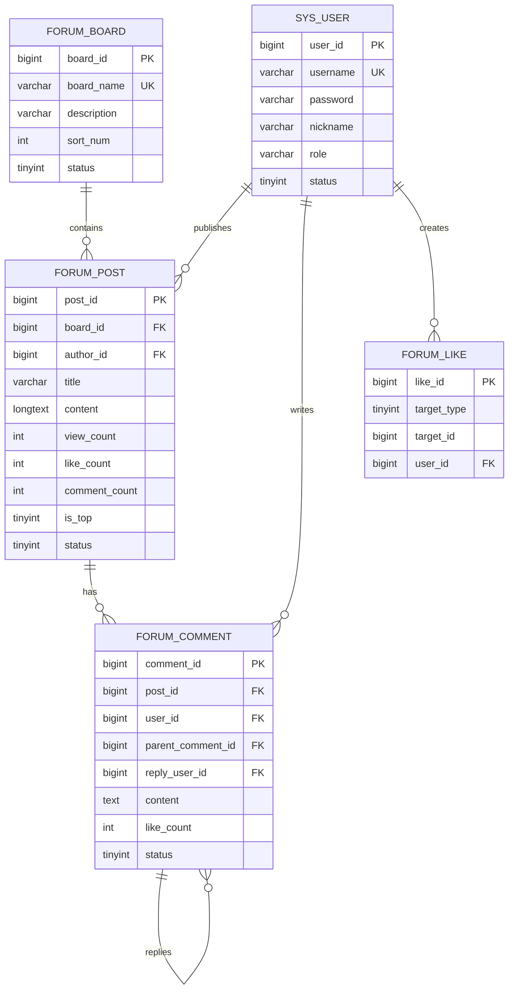

# 软件工程课题文档：CodeHouse 极简基础论坛系统

课程名称：软件工程  
课题名称：CodeHouse 极简基础论坛系统的分析与设计  
专业：软件工程  
指导教师：刘珺  
完成时间：2026 年 5 月

## 第1章 项目需求

### 1.1 项目背景

随着互联网交流方式的发展，用户对轻量级内容发布、信息浏览和互动反馈的需求不断增加。传统大型社区平台功能复杂，包含关注、私信、推荐、商业化运营等大量模块，不适合作为课程设计或小型团队内部交流系统；即时通讯工具虽然沟通实时性较强，但信息容易被刷屏，内容难以沉淀和检索。

因此，本项目设计并实现一个极简基础论坛系统 CodeHouse，重点保留用户注册登录、板块浏览、帖子发布、评论互动、点赞、后台管理等核心功能，形成完整的信息发布与互动闭环。系统当前已完成后端部分，后端提供 RESTful API、JWT 鉴权、用户权限控制、数据持久化和后台管理能力；前端部分尚未实现，但后端接口已经为后续 Vue 前端开发和接口联调提供基础。

### 1.2 相关研究

#### 1.2.1 用户群体分析

本系统主要面向课程设计展示、小型学习小组、开发团队和轻量社区用户。用户可以在系统中发布主题内容、查看板块信息、参与评论和点赞互动。系统用户分为普通用户和管理员两类。

普通用户关注操作简单、页面清晰、响应速度快，希望能够快速完成注册、登录、发帖、评论、点赞和个人内容管理。管理员关注系统内容秩序和基础运营能力，需要能够管理用户状态、论坛板块、帖子、评论、置顶内容以及查看统计数据。

#### 1.2.2 相关产品研究

现有论坛或社区产品功能丰富，但对课程设计和小型系统而言存在一定复杂度。大型社区平台通常包含推荐算法、粉丝关注、私信、通知、举报审核、广告运营等复杂功能，开发成本较高。传统论坛系统功能完整，但部署和二次开发成本较高。即时通讯工具适合实时交流，但不适合长期沉淀结构化内容。

本系统采用最小可用产品思路，仅实现论坛核心业务闭环。与大型平台相比，本系统功能边界更清晰，技术结构更适合课程设计；与即时通讯工具相比，本系统更适合内容沉淀、分类浏览和后台管理。

#### 1.2.3 用户需求获取

根据课程设计目标和当前后端实现情况，系统需求主要来自以下方面：一是论坛类系统的基本业务流程，包括注册、登录、发帖、评论、点赞和后台管理；二是当前项目后端已经实现的接口能力，包括认证接口、用户接口、板块接口、帖子接口、评论接口、点赞接口和管理员接口；三是后续前端开发需要，包括登录注册页面、论坛首页、帖子列表页、帖子详情页、个人中心和管理员后台页面。

需求优先级以“后端已实现、前端必须对接、系统验收必须展示”为主要依据，优先保证核心业务闭环完整，再考虑界面体验和后续扩展。

### 1.3 研究汇总

| 需求ID | 参与者 | 需求名称 | 需求描述 | 优先级别 |
|---|---|---|---|---|
| R001 | 普通用户 | 账号注册 | 用户填写用户名、密码、昵称完成注册，密码使用 BCrypt 加密存储 | 高 |
| R002 | 普通用户 | 用户登录 | 用户通过账号密码登录，登录成功后返回 JWT Token | 高 |
| R003 | 普通用户 | 浏览板块 | 用户登录后查看论坛板块列表 | 高 |
| R004 | 普通用户 | 发布帖子 | 用户选择板块，填写标题和正文后发布帖子 | 高 |
| R005 | 普通用户 | 查看帖子 | 用户查看帖子列表和帖子详情，详情访问时浏览量增加 | 高 |
| R006 | 普通用户 | 评论互动 | 用户可对帖子发表评论，并支持二级回复 | 高 |
| R007 | 普通用户 | 点赞互动 | 用户可对帖子或评论点赞、取消点赞，并查看点赞状态 | 中 |
| R008 | 普通用户 | 个人管理 | 用户可修改个人资料、修改密码、查看自己的帖子和评论 | 中 |
| R009 | 管理员 | 用户管理 | 管理员可查看用户列表，启用或禁用用户 | 高 |
| R010 | 管理员 | 板块管理 | 管理员可新增、编辑、删除、启用禁用板块并调整排序 | 高 |
| R011 | 管理员 | 内容管理 | 管理员可删除违规帖子和评论，设置帖子置顶 | 高 |
| R012 | 管理员 | 数据统计 | 管理员可查看用户、板块、帖子、评论、点赞数量和热门帖子 | 中 |

## 第2章 系统分析

### 2.1 核心功能分析

#### 2.1.1 应用场景分析

本系统适用于课程设计展示、小型学习社区、团队内部交流和轻量内容发布场景。普通用户可以通过系统完成账号注册、登录、浏览板块、发布帖子、查看帖子、评论和点赞等操作。管理员可以通过后台完成用户状态管理、板块维护、违规内容删除、帖子置顶和统计数据查看。

系统强调功能完整性和实现可控性，不追求复杂社交关系和推荐算法，而是保证基础论坛业务流程清晰、接口稳定、前后端易于联调。

#### 2.1.2 系统核心功能分析

系统功能划分为认证模块、用户模块、板块模块、帖子模块、评论模块、点赞模块和后台管理模块。

认证模块负责注册、登录和退出。用户模块负责当前用户资料、密码、个人帖子和个人评论。板块模块负责板块浏览和板块下帖子查询。帖子模块负责帖子发布、列表查询、详情查看、编辑、删除和置顶。评论模块负责评论发布、评论树展示和评论删除。点赞模块负责帖子和评论的通用点赞能力。后台管理模块负责用户、板块、内容和统计管理。

### 2.2 系统用例分析

#### 2.2.1 系统总体用例图



系统包含普通用户与管理员两类参与者。普通用户完成注册登录、浏览板块、发帖、评论、点赞和个人中心管理；管理员在普通业务能力基础上，额外具备用户管理、板块管理、内容管理和统计查看能力。

#### 2.2.2 核心模块用例图

认证与用户模块：



帖子、评论与点赞模块：



后台管理模块：



#### 2.2.3 核心用例事件流文档

| 分类 | 详细说明 |
|---|---|
| 用例名称 | 用户登录 |
| 参与者 | 普通用户、管理员 |
| 前置条件 | 用户已注册，账号未被禁用 |
| 后置条件 | 登录成功后返回 JWT Token 和用户信息 |
| 基本事件流 | 1. 用户提交用户名和密码；2. 后端查询用户；3. 使用 BCrypt 校验密码；4. 校验账号状态；5. 生成 JWT；6. 返回统一响应 |
| 扩展事件流 | 用户不存在时返回登录失败；密码错误时返回登录失败；账号被禁用时拒绝登录 |
| 业务规则 | 登录成功后，前端后续请求需携带 `Authorization: Bearer <token>` |
| 非功能需求 | 密码不得明文存储；Token 有过期时间；接口返回格式统一 |
| 补充说明 | `/auth/login` 为公开接口，不需要登录态 |

| 分类 | 详细说明 |
|---|---|
| 用例名称 | 发布帖子 |
| 参与者 | 普通用户、管理员 |
| 前置条件 | 用户已登录，目标板块存在且启用 |
| 后置条件 | `forum_post` 表新增帖子记录 |
| 基本事件流 | 1. 用户选择板块并填写标题、正文；2. 前端请求 `/posts/create`；3. 后端从 Token 获取当前用户；4. 校验标题、内容、板块；5. 保存帖子；6. 返回帖子信息 |
| 扩展事件流 | 未登录时被拦截；板块不存在时返回错误；标题或内容为空时返回参数错误 |
| 业务规则 | 作者 ID 不信任请求体，由后端根据当前登录用户写入 |
| 非功能需求 | 发帖接口需要鉴权；数据库写入失败时返回统一异常响应 |
| 补充说明 | 帖子支持浏览量、点赞数、评论数和置顶状态 |

| 分类 | 详细说明 |
|---|---|
| 用例名称 | 点赞帖子或评论 |
| 参与者 | 普通用户、管理员 |
| 前置条件 | 用户已登录，目标帖子或评论存在 |
| 后置条件 | `forum_like` 新增或删除点赞记录，目标对象点赞数同步更新 |
| 基本事件流 | 1. 用户点击点赞按钮；2. 前端提交 `targetType` 和 `targetId`；3. 后端校验目标类型；4. 查询是否已点赞；5. 新增点赞记录并更新计数；6. 返回操作成功 |
| 扩展事件流 | 重复点赞时返回冲突提示；取消未点赞对象时返回业务提示；目标不存在时返回错误 |
| 业务规则 | `targetType=1` 表示帖子，`targetType=2` 表示评论；同一用户不能重复点赞同一目标 |
| 非功能需求 | 点赞记录与计数更新在事务中完成 |
| 补充说明 | 数据库通过 `(target_type, target_id, user_id)` 唯一约束防止重复点赞 |

### 2.3 交互分析

#### 2.3.1 用例一：用户登录



登录过程中，前端只提交用户名和密码。后端根据用户名查询用户，校验密码和账号状态，校验通过后生成 JWT Token，并以统一响应结构返回。

#### 2.3.2 用例二：发布帖子



发布帖子时，作者 ID 由后端从 Token 中解析得到，避免前端伪造作者身份。Service 层负责校验板块、标题和内容，并将帖子写入数据库。

### 2.4 结构分析

#### 2.4.1 分析类的识别

实体类：

| 类名 | 属性 | 名称 |
|---|---|---|
| User | userId、username、password、nickname、avatar、signature、role、status、createTime、updateTime | 用户实体 |
| ForumBoard | boardId、boardName、description、sortNum、status、createTime、updateTime | 板块实体 |
| ForumPost | postId、boardId、authorId、title、content、viewCount、likeCount、commentCount、isTop、status、createTime、updateTime | 帖子实体 |
| ForumComment | commentId、postId、userId、parentCommentId、replyUserId、content、likeCount、status、createTime、updateTime、children | 评论实体 |
| ForumLike | likeId、targetType、targetId、userId、createTime | 点赞实体 |

控制类：

| 类名 | 属性 | 名称 |
|---|---|---|
| AuthController | login、register、logout | 认证控制器 |
| UserController | profile、updateProfile、updatePassword、posts、comments | 用户控制器 |
| ForumBoardController | getBoards、getBoardPosts | 板块控制器 |
| ForumPostController | create、detail、list、update、delete | 帖子控制器 |
| ForumCommentController | create、list、delete | 评论控制器 |
| ForumLikeController | like、unlike、status、count | 点赞控制器 |
| AdminController | 用户、板块、帖子、评论、统计后台接口 | 管理控制器 |

边界类：

| 类名 | 属性 | 名称 |
|---|---|---|
| REST API | `/auth/**`、`/user/**`、`/forum/**`、`/posts/**`、`/comments/**`、`/likes/**`、`/admin/**` | 前后端接口边界 |
| ResultUtil.Result | code、message、data | 统一响应边界 |
| JwtAuthenticationFilter | Authorization Header、SecurityContext | 认证边界 |
| GlobalExceptionHandler | 参数异常、状态异常、权限异常、通用异常 | 异常响应边界 |

#### 2.4.2 系统分析类图



## 第3章 系统设计

### 3.1 数据库设计

#### 3.1.1 概念模型

系统数据库包含 5 个核心实体：用户、板块、帖子、评论、点赞。



#### 3.1.2 数据表设计

系统数据库使用 MySQL 8.x，字符集为 `utf8mb4`，排序规则为 `utf8mb4_unicode_ci`。

| 表名 | 说明 | 关键字段 |
|---|---|---|
| `sys_user` | 用户表 | `user_id`、`username`、`password`、`nickname`、`avatar`、`signature`、`role`、`status` |
| `forum_board` | 板块表 | `board_id`、`board_name`、`description`、`sort_num`、`status` |
| `forum_post` | 帖子表 | `post_id`、`board_id`、`author_id`、`title`、`content`、`view_count`、`like_count`、`comment_count`、`is_top`、`status` |
| `forum_comment` | 评论表 | `comment_id`、`post_id`、`user_id`、`parent_comment_id`、`reply_user_id`、`content`、`like_count`、`status` |
| `forum_like` | 点赞表 | `like_id`、`target_type`、`target_id`、`user_id`、`create_time` |

#### 3.1.3 数据关系设计

`sys_user` 与 `forum_post` 是一对多关系，一个用户可以发布多篇帖子。`forum_board` 与 `forum_post` 是一对多关系，一个板块下可以包含多篇帖子。`forum_post` 与 `forum_comment` 是一对多关系，一篇帖子可以有多条评论。`forum_comment` 通过 `parent_comment_id` 实现自关联，用于支持二级评论。`sys_user` 与 `forum_comment` 是一对多关系，一个用户可以发布多条评论。`forum_like` 通过 `target_type` 和 `target_id` 实现对帖子和评论的通用点赞关系。

#### 3.1.4 数据约束与索引设计

| 表名 | 索引名 | 类型 | 字段 | 用途 |
|---|---|---|---|---|
| sys_user | uk_sys_user_username | UNIQUE | username | 登录账号唯一 |
| forum_board | uk_forum_board_name | UNIQUE | board_name | 板块名称唯一 |
| forum_post | idx_forum_post_board_id | 普通 | board_id | 按板块查帖子 |
| forum_post | idx_forum_post_author_id | 普通 | author_id | 按作者查帖子 |
| forum_post | idx_forum_post_create_time | 普通 | create_time | 按时间排序 |
| forum_comment | idx_forum_comment_post_id | 普通 | post_id | 按帖子查评论 |
| forum_comment | idx_forum_comment_user_id | 普通 | user_id | 按用户查评论 |
| forum_comment | idx_forum_comment_parent_comment_id | 普通 | parent_comment_id | 查询子评论 |
| forum_like | uk_forum_like_target_user | UNIQUE | target_type、target_id、user_id | 防止重复点赞 |
| forum_like | idx_forum_like_user_id | 普通 | user_id | 按用户查点赞 |
| forum_like | idx_forum_like_target | 普通 | target_type、target_id | 按目标查点赞 |

`forum_like` 通过 `target_type` + `target_id` 逻辑关联帖子或评论，未设置指向 `forum_post` 或 `forum_comment` 的外键约束。删除帖子或评论时，代码层在事务中通过 `forumLikeMapper.deleteByTarget()` 手动清理关联点赞记录，避免孤儿数据。

### 3.2 体系结构设计

#### 3.2.1 系统架构风格选择

本系统采用前后端分离架构和后端分层架构。前端负责页面展示、路由跳转、表单交互、Token 存储和接口调用；后端负责身份认证、权限校验、业务处理、数据访问和统一响应；数据库负责持久化存储用户、板块、帖子、评论和点赞数据。

```text
Vue 3 前端应用
    ↓ Axios 请求
Spring Boot REST API
    ↓ Service 业务处理
MyBatis Plus / Mapper XML
    ↓
MySQL 数据库
```

后端采用 Controller、Service、Mapper、Entity 分层结构。Controller 层接收请求并返回统一响应；Service 层处理业务规则；Mapper 层访问数据库；Entity 层对应数据库核心实体。

#### 3.2.2 系统层次结构设计

表现层：当前仓库主要为后端工程，后端对外提供 RESTful API。前端可采用 Vue 3、Vite、Element Plus、Axios、Pinia、Vue Router 实现页面展示和接口调用。

控制层：由 `AuthController`、`UserController`、`ForumBoardController`、`ForumPostController`、`ForumCommentController`、`ForumLikeController`、`AdminController` 组成，负责接收 HTTP 请求、解析参数、调用 Service，并通过 `ResultUtil.Result<T>` 返回统一 JSON。

业务逻辑层：由 `UserService`、`ForumBoardService`、`ForumPostService`、`ForumCommentService`、`ForumLikeService`、`StatisticsService` 及其实现类组成，负责注册登录、权限校验、帖子评论点赞业务、后台管理和统计查询。

数据访问层：由 `UserMapper`、`ForumBoardMapper`、`ForumPostMapper`、`ForumCommentMapper`、`ForumLikeMapper` 及对应 XML 文件组成，通过 MyBatis Plus 和 XML SQL 访问 MySQL 数据库。

数据层：采用 MySQL 8.x，数据库名为 `software_engineering_forum`，包含 `sys_user`、`forum_board`、`forum_post`、`forum_comment`、`forum_like` 五张核心表。

#### 3.2.3 接口通信机制

系统对外提供 RESTful API，所有业务接口统一返回 JSON。除 `/auth/**` 和 API 文档地址外，其余接口均需要在请求头携带 `Authorization: Bearer <token>`。

统一响应格式如下：

```json
{
  "code": 200,
  "message": "操作成功",
  "data": {}
}
```

主要接口分组如下：

| 模块 | 路径前缀 | 说明 |
|---|---|---|
| 认证接口 | `/auth/*` | 注册、登录、退出 |
| 用户接口 | `/user/*` | 个人资料、密码、我的帖子、我的评论 |
| 板块接口 | `/forum/*` | 板块列表、板块帖子 |
| 帖子接口 | `/posts/*` | 发布、列表、详情、编辑、删除 |
| 评论接口 | `/comments/*` | 发布、评论树、删除 |
| 点赞接口 | `/likes/*` | 点赞、取消点赞、状态、计数 |
| 管理接口 | `/admin/*` | 用户、板块、内容、统计管理 |

#### 3.2.4 系统部署架构设计

后端服务基于 Spring Boot 3.3.5 构建，运行环境要求 JDK 21、Maven 3.8+ 和 MySQL 8.x。应用默认端口为 `8080`，数据库连接通过环境变量配置。

数据库初始化脚本为 `SoftwareEngineering.sql`，演示数据脚本为 `demo_data.sql`。构建后可通过以下方式启动：

```bash
mvn clean package
java -jar target/Software-Engineering-0.0.1-SNAPSHOT.jar
```

服务启动后，可访问 Knife4j 文档地址 `http://localhost:8080/doc.html` 和 Swagger UI 地址 `http://localhost:8080/swagger-ui.html`。

#### 3.2.5 系统安全设计

系统采用 Spring Security + JWT 的无状态认证方式。用户登录成功后，后端生成 Token；前端后续请求携带 Token；后端通过 `JwtAuthenticationFilter` 解析 Token 并写入 Spring Security 上下文。

密码使用 BCrypt 单向哈希加密存储。管理员接口 `/admin/**` 仅允许 `ADMIN` 角色访问。普通用户在编辑或删除帖子、评论时，后端校验资源归属，确保用户只能操作自己的内容。SQL 层使用 MyBatis 参数绑定，避免字符串拼接带来的 SQL 注入风险。

### 3.3 构件设计

| 构件名称 | 核心功能描述 | 关键接口 |
|---|---|---|
| 用户认证构件 | 处理用户注册、登录、退出、JWT 生成、密码加密与身份解析 | `/auth/register`、`/auth/login`、`/auth/logout` |
| 用户管理构件 | 处理个人资料、密码修改、我的帖子、我的评论 | `/user/profile`、`/user/update/profile`、`/user/update/password`、`/user/posts`、`/user/comments` |
| 板块管理构件 | 处理板块列表、板块帖子查询、后台板块新增、编辑、状态、排序和删除 | `/forum/boards`、`/forum/board/posts`、`/admin/forums/**` |
| 帖子管理构件 | 处理发布、列表、详情、编辑、删除、搜索、浏览量统计、置顶 | `/posts/create`、`/posts/list`、`/posts/detail`、`/posts/update`、`/posts/delete`、`/admin/posts/{postId}/top` |
| 评论管理构件 | 处理一级评论、二级回复、评论树展示、评论删除、评论数同步 | `/comments/create`、`/comments/list`、`/comments/delete`、`/admin/comments/{commentId}` |
| 点赞管理构件 | 处理帖子和评论通用点赞、取消点赞、点赞状态、点赞数量 | `/likes/like`、`/likes/unlike`、`/likes/status`、`/likes/count` |
| 后台统计构件 | 处理用户、板块、帖子、评论、点赞数量汇总和热门帖子查询 | `/admin/statistics/overview`、`/admin/statistics/hot-posts` |
| 统一响应与异常构件 | 统一接口响应结构，处理参数异常、状态异常、鉴权异常和通用异常 | `ResultUtil`、`GlobalExceptionHandler` |
| 数据访问构件 | 通过 Mapper 和 XML SQL 访问 MySQL 数据库 | `UserMapper`、`ForumBoardMapper`、`ForumPostMapper`、`ForumCommentMapper`、`ForumLikeMapper` |

### 3.4 UI设计

当前项目仓库主要完成后端与数据库部分，前端 UI 尚未开发。本章节暂不填具体界面草图。

## 第4章 系统测试

### 4.1 测试计划

本阶段测试范围覆盖后端和数据库相关内容：

1. Spring Boot 应用上下文启动。
2. 登录、JWT 生成、接口鉴权和管理员权限控制。
3. 帖子、评论、点赞 Service 主业务分支。
4. 帖子、评论、点赞 Controller 的请求参数、统一响应和当前用户注入。
5. 板块接口、后台管理接口和异常响应。
6. 后台统计 Service 汇总逻辑。
7. OpenAPI 文档生成和核心接口路径。
8. 真实 MySQL 联调测试入口编译与显式执行开关。

测试环境如下：

| 项目 | 当前值 |
|---|---|
| 操作系统 | Windows |
| JDK | Java 21 |
| 构建工具 | Maven |
| 后端框架 | Spring Boot 3.3.5 |
| 数据库驱动 | MySQL Connector/J |
| 测试框架 | JUnit 5、Mockito、Spring Boot Test、MockMvc |

### 4.2 测试用例

最近一次常规回归命令：

```powershell
mvn test
```

执行结果：

```text
Tests run: 60, Failures: 0, Errors: 0, Skipped: 0
```

| 功能模块 | 测试步骤 | 测试用例 | 预期结果 |
|---|---|---|---|
| 应用启动 | 执行 Spring Boot 上下文测试 | `SoftwareEngineeringApplicationTests` | 上下文正常加载 |
| 安全鉴权 | 登录、未登录访问、USER/ADMIN 权限访问 | `SecurityControllerTest` 6 个用例 | 登录返回 token；权限边界正确 |
| 帖子业务 | 发布、详情、删除、作者权限校验 | `ForumPostServiceImplTest` 7 个用例 | 帖子主流程正常，非作者删除被拒绝 |
| 评论业务 | 发布评论、评论树、删除评论、清理点赞 | `ForumCommentServiceImplTest` 6 个用例 | 评论数同步正确，评论树返回正常 |
| 点赞业务 | 点赞、重复点赞、取消点赞 | `ForumLikeServiceImplTest` 4 个用例 | 重复点赞被拦截，计数同步正确 |
| 统计业务 | 统计概览、热门帖子默认限制和上限限制 | `StatisticsServiceImplTest` 3 个用例 | 统计结果正确 |
| 帖子/评论/点赞接口 | 使用 MockMvc 测试 Controller 请求与响应 | `ForumBusinessControllerTest` 9 个用例 | 统一响应、参数透传和当前用户注入正确 |
| 板块接口 | 查询板块列表、查询板块帖子、未登录拦截 | `ForumBoardControllerTest` 4 个用例 | 板块接口响应正确 |
| 后台接口 | 用户、板块、帖子、评论、统计管理 | `AdminControllerTest` 14 个用例 | 管理员接口可用，普通用户不可访问 |
| 异常响应 | 参数异常、状态异常、JWT 无效、空 data | `ExceptionResponseTest` 5 个用例 | 异常响应格式统一 |
| API 文档 | 生成 OpenAPI 文档并检查核心路径 | `OpenApiDocumentationTest` 1 个用例 | `/v3/api-docs` 包含核心接口 |
| 数据库联调 | 真实 MySQL 连接和核心 Mapper 只读 SQL 验证 | `DatabaseIntegrationIT` 2 个用例 | 服务器 MySQL 环境下通过 |

数据库联调已在服务器 MySQL（101.35.44.133）环境中验证通过，覆盖 `UserMapper`、`ForumBoardMapper`、`ForumPostMapper`、`ForumCommentMapper`、`ForumLikeMapper` 的核心只读 SQL。

## 第5章 总结

当前项目已经完成后端与数据库主体内容。后端基于 Spring Boot 3.3.5、Spring Security、JWT、MyBatis Plus 和 MySQL 实现，已经具备注册登录、用户资料、板块浏览、帖子发布与管理、评论互动、帖子/评论通用点赞、后台管理和统计概览能力。数据库包含用户、板块、帖子、评论、点赞五张核心表，具备主外键关系、唯一约束、索引和逻辑状态字段。

项目已经建立自动化测试体系，常规回归测试共 60 个用例全部通过，并完成真实 MySQL 数据库联调验证。当前可作为课程设计后端与数据库部分的文档填写基础，前端 UI 草图和界面实现内容待前端开发完成后继续补充。
